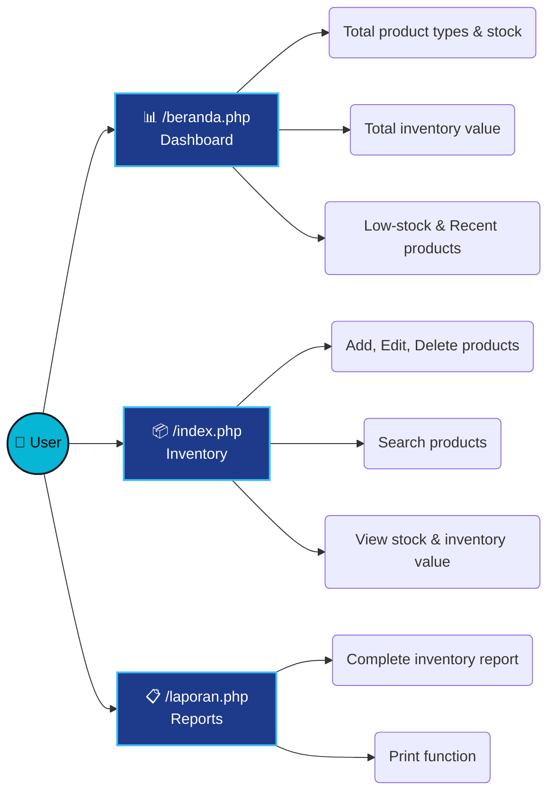

<!-- Animated 3D Wave Header with Blinking Neon Effect -->

<!-- Animated Rainbow Neon Line -->

 

<!-- 3D Tech Stack Icons -->

  

---

<!-- SPLIT-SCREEN HERO SECTION -->
<table>
  <tr>
    <td width="60%" valign="middle">
      <h2>📦 Warehouse Inventory System</h2>
      
A simple web-based inventory management system built with <b>PHP</b> and <b>MySQL</b>.

      
This application is designed to help manage warehouse inventory, including product data, stock quantities, prices, inventory value, and printable inventory reports.

      

      <b>🛠️ Core Technologies:</b> 
      <code>PHP</code> • <code>MySQL</code> • <code>PDO</code> • <code>HTML5</code> • <code>CSS3</code> • <code>JavaScript</code> • <code>Bootstrap CDN</code>
    </td>
    <td width="40%" align="center" valign="middle">
      <!-- Animated Coding / Data Processing GIF -->
      
    </td>
  </tr>
</table>

## ✨ Features (Bento Grid View)

<table>
  <tr>
    <td width="33%" valign="top">
      <h3 align="center">📊 Smart Dashboard</h3>
      <ul>
        <li>📊 Inventory dashboard</li>
        <li>📉 Low-stock detection</li>
        <li>💰 Automatic inventory value calculation</li>
        <li>🖥️ Desktop-friendly dashboard</li>
      </ul>
    </td>
    <td width="33%" valign="top">
      <h3 align="center">📦 Stock Control</h3>
      <ul>
        <li>📦 Product inventory management</li>
        <li>➕ Add products</li>
        <li>✏️ Edit products</li>
        <li>🗑️ Delete products</li>
        <li>🔎 Search inventory</li>
      </ul>
    </td>
    <td width="33%" valign="top">
      <h3 align="center">🖨️ Reports & UI</h3>
      <ul>
        <li>📋 Inventory reports</li>
        <li>🖨️ Print reports</li>
        <li>📱 Responsive mobile interface</li>
      </ul>
    </td>
  </tr>
</table>

---

## 📊 Main Pages Architecture

| Route | Page Name | Core Functionality |
| --- | --- | --- |
| **`/beranda.php`** | **Dashboard** | Displays: Total product types, Total stock, Total inventory value, Low-stock products, and Recently added products. |
| **`/index.php`** | **Inventory** | Used to: Add products, Edit products, Delete products, Search products, View stock, and View inventory value. |
| **`/laporan.php`** | **Reports** | Displays a complete inventory report and provides a print function. |

---

## ⚡ Interactive System Blueprint

*(Click the arrows below to expand each technical section)*

**Database:** `gudang` | **Main table:** `barang`

| Column | Description |
| --- | --- |
| **`id`** | Product ID |
| **`nama_barang`** | Product Name |
| **`jumlah`** | Stock Quantity |
| **`harga_per_pcs`** | Price Per Unit |
| **`created_at`** | Creation Date |
| **`updated_at`** | Last Update Date |

---

## 🔐 Security & 📱 Responsive Design

---

## 📄 License

This project was created for educational and inventory management purposes.
